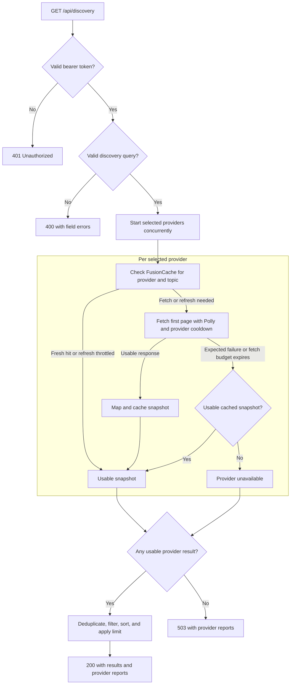

# Discovery request flow

`GET /api/discovery` validates the bearer token and query before starting
provider work. The provider branch runs concurrently for every selected source.

A successful provider can return an empty result. Stale, incomplete, or
unavailable provider results make a successful aggregate partial. Unexpected
exceptions go through the API exception handler and return a sanitized
`500` with a trace ID. A caller cancellation stops the request.

Each outbound transport attempt, including a retry, records an observation
in the statistics channel. The single reader publishes immutable snapshots
for `GET /api/statistics` and the latency monitor. Cache hits and requests
rejected before reaching transport add no observations.

See the [API examples](api-examples.md) and the
[cache decision](adr/0001-fusioncache-memory-only.md) for the response contract
and cache policy.
